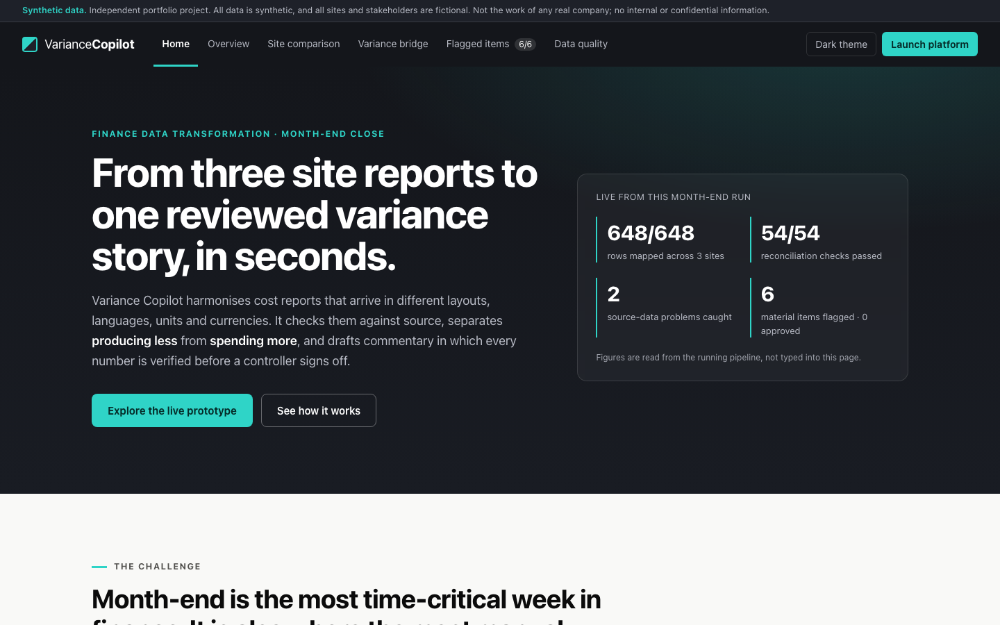
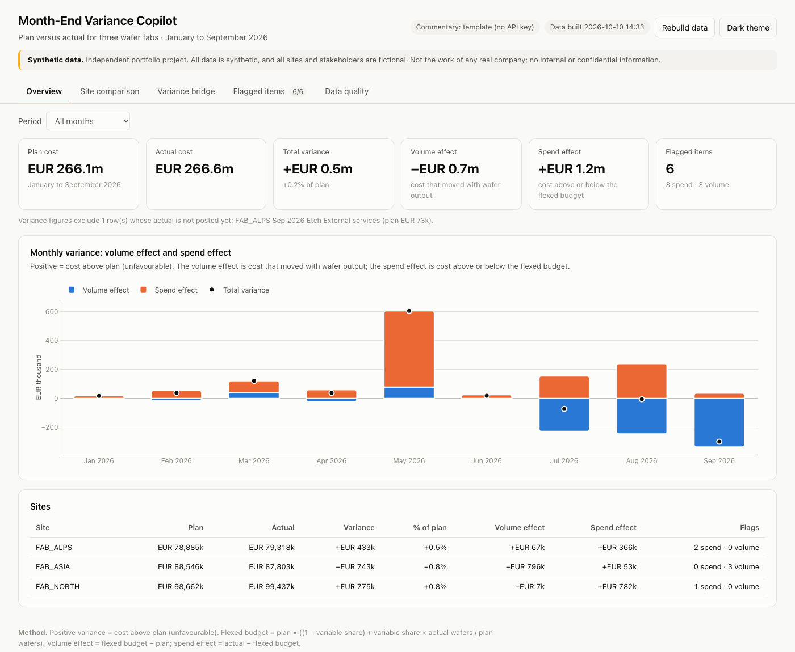

# Finance Month-End Variance Copilot

> **Independent portfolio project. All data is synthetic, and all sites and stakeholders are fictional. This is not the work of any real company and contains no internal or confidential information.**

At month-end, three fictional wafer fabs each send a cost report in their own layout, language, unit and currency. This prototype turns them into one reviewed variance report:

1. **Harmonise:** one reporting table on the group chart of accounts, in EUR, with the local codes and the source line kept on every row.
2. **Check:** duplicates, missing actuals and unmapped codes are reported, and every site and month is reconciled to the source.
3. **Analyse:** plan-versus-actual variances are split into a **volume effect** (fewer or more wafers) and a **spend effect** (cost above or below the flexed budget). Material items are flagged.
4. **Explain:** commentary is drafted from the calculated figures only. **Every number in it is checked against the data**, the cost-centre owner can add the cause, and a controller approves it.





## Quick start

Requires Python 3.11 or later.

```bash
python3 -m venv .venv
.venv/bin/pip install -r requirements.txt

.venv/bin/python -m src.pipeline.run      # build everything from the raw files (about 1 s)
.venv/bin/python -m app.backend           # start the app, then open http://127.0.0.1:8000
.venv/bin/python -m pytest                # all quality gates
```

The commentary works without any API key: a fixed template writes the drafts. To let Claude write them, copy `.env.example` to `.env`, add `ANTHROPIC_API_KEY`, and redraft with `.venv/bin/python -m src.commentary.run --regenerate`. Only rounded, aggregated figures for one flagged item are sent, and the same number check applies.

## What you see

| View | Shows |
|---|---|
| Home | Landing page: the problem, how the platform works, live proof points read from the pipeline, AI controls, impact by role, before/after hours |
| Overview | Plan, actual, variance, volume and spend effect; monthly split; one row per site |
| Site comparison | Cost per wafer, plan and actual; monthly trend; variance % by site and cost type |
| Variance bridge | Volume effect plus spend effect per cost type = total variance, per site and month, with every underlying row and its source line |
| Flagged items | The six material items with their figures, draft commentary, number-check result, owner cause, edit / regenerate (English or German) / approve |
| Data quality | Rows loaded and mapped, findings, and 54 reconciliation checks |

## How it works

```
data/raw/*.csv ─► ingest.py ─► raw_* ─► SQL staging ─► mapping gate ─► rpt_harmonised (648 rows)
                                                                          │
                     dq_report, dq_reconciliation ◄── quality.py ◄────────┤
                                                                          ▼
                                          analytics/variance.py ─► an_variance, flags, cost per wafer
                                                                          ▼
   commentary: context.py ─► llm.py (Claude or template) ─► number_check.py ─► review.py
                                                                          ▼
                              app/backend (FastAPI JSON API) ─► app/frontend (HTML + Plotly.js)
```

- **Storage:** DuckDB. `data/warehouse/variance.duckdb` is rebuilt on every run, so results are identical. Approvals and owner causes live in `data/review/review.duckdb`, which survives rebuilds.
- **Method:** flexed budget = plan × ((1 − variable share) + variable share × actual wafers / plan wafers). Volume effect = flexed − plan; spend effect = actual − flexed. Positive = cost above plan. The variable shares are an assumption, kept in `data/reference/cost_behaviour.csv`.
- **Flags:** spend effect of at least EUR 50,000 **and** 5 % of the flexed budget; or wafers at least 5 % off plan. Thresholds are in `config.yaml`.
- **Controls on AI text:** the model receives only the item's rounded figures. Any number not in that context fails the check. A failing draft is regenerated once, then replaced by the template. Only a draft that passes can be approved. Every prompt, answer and check is logged in `logs/llm_log.jsonl`.

## Results on the synthetic data

| Success criterion | Target | Result |
|---|---|---|
| SC-1 rows mapped | 100 % | 648 / 648 |
| SC-2 reconciliation | < 0.01 % | 54 / 54 checks, difference EUR 0.00 |
| SC-3 planted data issues found | 2 of 2 | 2 of 2 |
| SC-4 planted business events flagged | 3 of 3 | 3 of 3, and no other flags |
| SC-5 commentary figures traceable | 100 % | enforced: unchecked text cannot be approved |
| SC-6 one-command run | < 2 min | 0.9 s from an empty database |
| SC-7 automated tests | all passing | see `docs/evidence/test_report.txt` |
| SC-8 business case | one page | [`docs/business_case.md`](docs/business_case.md) |

## Repository

| Path | Content |
|---|---|
| `docs/` | Project documents 01–08 (Word and markdown), [architecture](docs/architecture.md), [build log](docs/build_log.md), [decisions for doc 07](docs/log_entries_for_07.md), [business case](docs/business_case.md), [demo script](docs/demo_script.md), screenshots, evidence |
| `data/raw/`, `data/reference/` | Synthetic input and maintained mapping tables |
| `src/generate_data.py` | Synthetic data generator (fixed seed) |
| `src/pipeline/` | Raw load, SQL staging and reporting, data quality, one-command run |
| `src/analytics/variance.py` | Variance, decomposition, flags, cost per wafer |
| `src/commentary/` | Context, Claude client and template, number check, review store |
| `app/backend/`, `app/frontend/` | API and web frontend |
| `knime/` | Node-by-node KNIME rebuild of the harmonisation and an automatic parity check |
| `tests/` | Quality gates for every work package |

## Limits

Synthetic data with an illustrative cost structure; file input only; one local user with no login; no forecasting, accruals or balance-sheet topics. Not tested against a live language-model API on the build machine (no key); that path is covered by tests with a simulated model.
